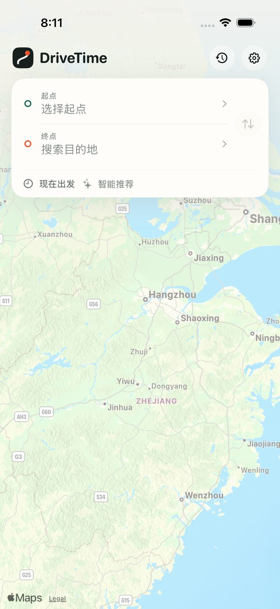
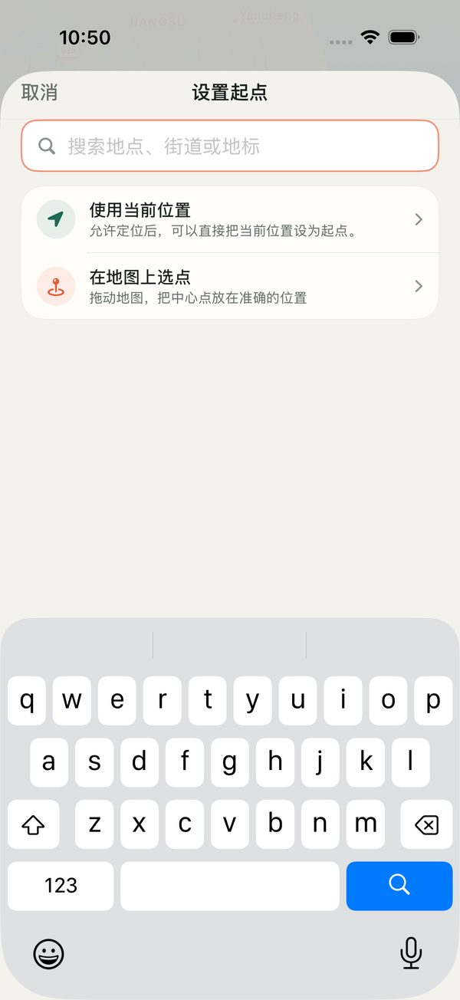
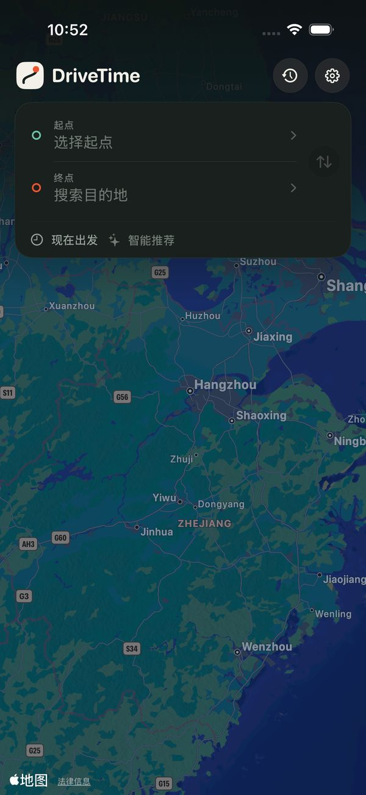
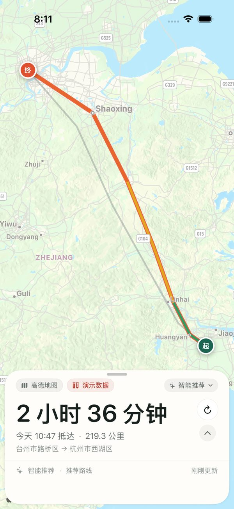
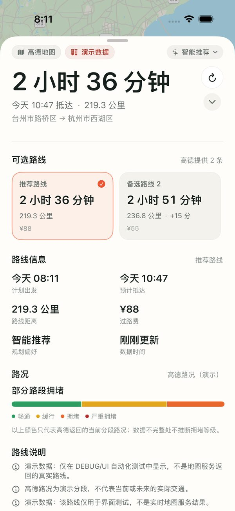
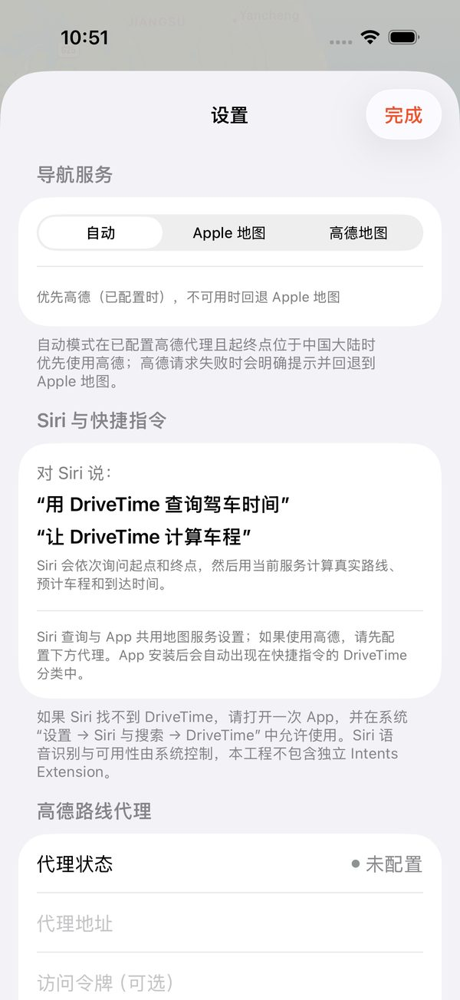
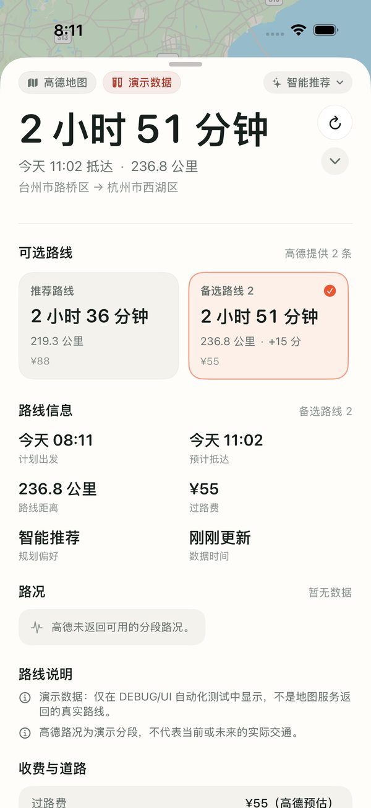

# DriveTime

DriveTime 是一款原生 iOS 驾车耗时与到达时间查询工具。它不做完整导航，只专注于回答一个问题：**从当前或计划的时间出发，走真实道路路线，要多久才能到？**

- **原生 SwiftUI**，最低 iOS 17，无 WebView、无 Flutter/React Native、无网页套壳。
- 路线、距离、预计耗时、过路费和路况都来自真实地图服务：**Apple MapKit** 与 **高德地图 Web 服务（经 Cloudflare Worker 代理）**。
- **Siri / App Intents**：说“用 DriveTime 查询驾车时间”，Siri 询问起点和终点后朗读真实车程，并显示路线摘要卡片。
- 不使用直线距离 ÷ 固定速度伪造 ETA。
- 通过 GitHub Actions 在云端编译真正面向 **iPhoneOS** 的 `.app`，打包为 **未签名 IPA**。
- 默认 Bundle ID 为 `com.example.drivetime`，可在重签名前替换。

> **验证状态（2026-11-21，v0.2.0 + Siri）**：提交 `c186ac7` 已通过云端 CI。
>
> - **iOS Device Build**：成功，生成真实 **iPhoneOS arm64** 未签名 IPA。
> - **GitHub Release v0.2.0**：https://github.com/zhw000/DriveTime/releases/tag/v0.2.0；Release IPA SHA-256 `a753b2cf0b08d20d930fa736800a07792a6bd7ee6f9d0eb95e460eb0c7e1cefd`，1,268,599 bytes。
> - **iOS Simulator Tests**：单元测试 **63 通过 / 0 失败 / 1 跳过**；UI 测试 **4/4 通过**。
> - **Siri 构建证据**：构建日志确认生成 `Metadata.appintents`，App Shortcut 短语以 **zh-Hans** 训练；语音唤起本身未在 CI 验证。
> - 环境：macOS 26、Xcode 26.6、iPhone 17 Pro Simulator（iOS 26.5）。
> - 跳过的是真实 Apple MapKit 在线路线测试（Simulator 返回 `serverUnavailable`）；高德尚未使用真实 Key 联调。
> - **尚未在真实 iPhone 上安装验证 Siri 或其他功能**；签名后的安装受证书、Profile、Bundle ID 和设备影响。
>
> 详细运行链接、产物校验与测试证据见 [`Docs/Verification.md`](Docs/Verification.md)。

---

## 目录

1. [功能](#功能)
2. [真实数据原则与限制](#真实数据原则与限制)
3. [Siri 与快捷指令](#siri-与快捷指令)
4. [截图与界面](#截图与界面)
5. [工程结构](#工程结构)
6. [本地环境要求](#本地环境要求)
7. [生成 Xcode 工程](#生成-xcode-工程)
8. [GitHub Actions 构建](#github-actions-构建)
9. [下载未签名 IPA 并自行签名](#下载未签名-ipa-并自行签名)
10. [Bundle ID 与重签名](#bundle-id-与重签名)
11. [高德地图配置](#高德地图配置)
12. [坐标系](#坐标系)
13. [测试](#测试)
14. [验证状态与已知限制](#验证状态与已知限制)
15. [常见构建问题](#常见构建问题)
16. [真机验收清单](#真机验收清单)
17. [数据来源与隐私](#数据来源与隐私)

---

## 功能

### 已实现

- **Apple MapKit**
  - `MKLocalSearch` 地点搜索、`MKLocalSearchCompleter` 自动补全、`MKDirections` 驾车路线。
  - 明确使用 `.automobile`，不会把步行/公交路线当驾车路线。
  - 当 MapKit 返回多条路线时支持备选切换。
  - 真实折线几何，不使用直线代替道路。
  - 纯 ETA 查询接口（`calculateETA`）独立实现；内部区分“有轨迹的路线”和“无轨迹的 ETA 结果”。
- **高德地图**
  - 使用高德 **路径规划 2.0** `/v5/direction/driving`，不混用 v3 参数。
  - `strategy` 驱动偏好：智能推荐 32、躲避拥堵 33、高速优先 34、不走高速 35、少收费 36、速度最快 38。
  - 固定请求 `show_fields=cost,tmcs,polyline,navi,cities`。
  - 解析字符串形式的距离/耗时、过路费、收费里程、收费道路、红绿灯数量、分段 TMC 路况和折线。
  - 只展示服务实际返回的路线数量；不会把一条路线拆成多条“备选”。
  - 缺失费用、路况或轨迹时显示“暂无数据”/说明，不补假数字。
- **地点输入**
  - 起点/终点搜索、自动补全、交换起终点、当前位置、地图选点、最近地点、收藏地点。
  - 搜索防抖；过期请求不会覆盖最新结果；任务可取消。
- **行程结果**
  - 大号预计车程、距离、预计到达时刻、出发时刻、路线偏好、服务来源、查询时间。
  - 预计到达 = **请求快照的出发时刻 + 地图服务返回耗时**，不受渲染延迟或重新读取系统时间影响。
  - 备选路线时间差/距离差来自真实返回值。
  - 刷新路况，带客户端冷却、URLSession 限频与 Worker 服务端限流。
  - SwiftData 历史记录、收藏路线、旧数据标记与重新查询。
- **计划出发时间**
  - 现在、稍后一小时、明天早上、自定义日期时间。
  - 当前接口不支持可信的未来交通预测时，界面明确标注“未来时刻推算”，不冒充预测。
- **Siri / App Intents**
  - 说“用 DriveTime 查询驾车时间”“让 DriveTime 计算车程”或“问 DriveTime 这段路要开多久”。
  - Siri 会依次询问起点和终点，后端使用与 App 相同的真实路线服务，朗读预计车程、到达时间和距离，并显示 Siri 摘要卡片。
  - 同一个 Intent 也会自动出现在“快捷指令”App 的 DriveTime 分类，支持手动填写起点/终点或在自动化中调用。
  - 无独立 Intents Extension；App Shortcuts 元数据以中文（zh-Hans）构建。更详细的限制见 [Siri 与快捷指令](#siri-与快捷指令)。
- **UI / 无障碍**
  - 原生 `Map`、原生 Sheet `presentationDetents`、Dynamic Type、深色模式、Reduce Motion 处理、VoiceOver 标签、安全区与横屏布局。
  - 默认浅色，自动适配深色。
  - 无账号、无广告、无分析 SDK、无多余底部 Tab。
- **安全与隐私**
  - 高德 Web Service Key 只存在 Cloudflare Worker Secret，不进入 App、UserDefaults、源码或 CI。
  - 可选代理访问令牌只保存在 iOS Keychain。
  - Worker 验证请求参数、固定返回字段、限制响应大小/方法/频率，并支持 Bearer Token。

### 不在本版本范围

- 逐向语音导航、后台持续定位、导航中剩余里程动态更新。
- 完整 SiriKit 领域集成（来电、消息等）；本项目只使用 App Intents/App Shortcuts。
- 高德 iOS SDK 的离线地图或导航能力（本项目用 Web 服务 + MapKit 渲染）。
- 账号同步、广告、订阅。
- 真实未来时刻交通预测（当前接入的接口不提供）。

---

## 真实数据原则与限制

1. **ETA 来自地图服务。** 不使用固定车速、经纬度直线距离或虚构系数修正。
2. **路线折线必须来自服务。** 高德若没有完整 step/path 轨迹，会显示“未返回完整路线轨迹”，地图只画起终点，绝不画直线冒充路线。
3. **只有返回多条才展示多条。** 高德 v5 驾车通常一个 strategy 返回一条；不重复请求凑方案。
4. **缺失字段不补零。** 费用、路况、收费里程缺失时显示“暂无数据”，不显示 `¥0` 或“畅通”。
5. **未来出发不冒充预测。** 当前接口没有预测参数；结果标记“未来时刻推算”，提示按当前路况估算。
6. **错误不静默替换成模拟数据。** 自动模式从高德回退 Apple 时，结果说明会明确写出“已改用 Apple 地图”。
7. **演示数据只在 DEBUG。** UI 自动化测试使用 `-DriveTimeDemo`，界面明确标注“演示数据”；Release 编译剔除，正常启动不触发。

### 高德资料

- 路线规划 2.0：<https://lbs.amap.com/api/webservice/guide/api/newroute>
- 驾车接口：`https://restapi.amap.com/v5/direction/driving`
- 搜索 POI 2.0：<https://lbs.amap.com/api/webservice/guide/api-advanced/newpoisearch>

注意路线 2.0 与 v3 的字段和 `strategy` 含义不同，不能混用。高德距离、耗时等字段经常是字符串，本项目有容错解码器。

### 高德是否真实联调

- Worker、请求参数、AMap JSON 解析、错误码和字段缺失均有自动化测试。
- **仓库不包含高德 Key，因此没有用真实高德账号完成在线路线查询。** 配置有效 Key 后的结果需要你按本文验证。
- Apple MapKit 不依赖仓库密钥，真机网络可用时可直接查询。

---

## Siri 与快捷指令

DriveTime 已接入 **App Intents + App Shortcuts**。安装后可以直接用 Siri 查询两个地点之间的真实驾车时间，不需要先打开 App、也不需要手动启动导航。

### 可以怎么说

- 嘿 Siri，**用 DriveTime 查询驾车时间**
- 嘿 Siri，**让 DriveTime 计算车程**
- 嘿 Siri，**问 DriveTime 这段路要开多久**

Siri 会依次询问：

1. **从哪里出发？** → 说出起点
2. **要去哪里？** → 说出终点

然后 DriveTime 会调用当前配置的真实地图服务，Siri 朗读例如：

> 从台州市路桥区到杭州市西湖区，预计 2 小时 36 分钟，今天 16:45 到达，全程 219 公里。

同时显示一张 Siri 摘要卡片，包含预计车程、抵达时间、距离、路线来源和必要的回退/错误提示。

同一个 Intent 也会自动出现在“快捷指令”App 的 DriveTime 分类下，名称为“查询车程”，可手动填写起点和终点，也可以作为快捷指令自动化的一个动作。

### 实现方式与边界

- 使用 `AppIntent` + `AppShortcutsProvider`，**没有单独的 Intents Extension**。
- `SiriRouteQueryService` 复用 App 的偏好设置、ProviderResolver、Apple/高德真实服务、中文错误文案和自动回退逻辑；Siri 不会返回模拟路线。
- 地点搜索由 Apple MapKit 完成；路线仍遵循当前“自动 / Apple / 高德”服务选择。
- App Shortcut 短语约束下使用无动态参数的短语，Siri 通过参数提问收集起点/终点。
- App 的开发语言/App Shortcut 元数据为 **zh-Hans**；构建日志中实际看到 `Training ... for zh-Hans`，IPA 内包含 `Metadata.appintents`。
- 已添加 `NSSiriUsageDescription`。本工程只使用 App Shortcuts，不包含 Intents Extension，也没有添加额外的 Siri entitlement；普通重签流程不变。如果你以后扩展为完整 SiriKit 领域（如消息/通话），需要另行启用 Siri capability 并让 Provisioning Profile 支持对应 entitlement。
- **Bundle ID 警告**：Siri 的 App Intents 元数据在构建时写入 Bundle ID。若签名工具只修改 Info.plist 的 Bundle ID 而不重新构建，Siri 可能无法发现快捷指令。最可靠的方式是先在 `project.yml` 中修改 Bundle ID，再让 CI 重新构建并签名；或使用默认/匹配原始元数据的 Bundle ID。
- 必须满足：设备已启用 Siri、Siri 使用中文（普通话）、App 已安装并至少启动一次、系统“Siri 与搜索 → DriveTime”已启用。
- 如果 Siri 找不到快捷指令，打开“快捷指令”App，确认“查询车程”已出现在 DriveTime 分类，并直接用该快捷指令测试；也可将快捷指令加入 Siri。
- **真实 Siri 语音唤起尚未在 CI 或真机上验证**；CI 只验证了代码编译、App Intents 元数据生成和 zh-Hans NLU 短语训练。

### Siri 查询的数据流

```
Siri → DriveTimeRouteIntent → SiriRouteQueryService
                              ├─ Apple MKLocalSearch 解析起点/终点
                              ├─ 当前设置选择 Apple MapKit 或高德 Provider
                              ├─ 真实路线请求；自动模式可显式回退 Apple
                              └─ 朗读车程 + 显示摘要卡片
```

Siri 查询不写入历史记录（避免后台语音查询频繁污染历史）；如需完整路线、路况和备选方案，请打开 App 查看。

---

## 截图与界面

以下截图来自通过 CI 的 iOS Simulator UI 测试（iPhone 17 Pro，iOS 26.5），原图也保存在 [`Docs/Screenshots`](Docs/Screenshots)。底部地图与真实服务使用相同的 MapKit 组件；路线结果截图使用界面上明确标注的 DEBUG 演示数据。

<table>
  <tr>
    <td align="center"></td>
    <td align="center"></td>
    <td align="center"></td>
  </tr>
  <tr>
    <td align="center">首页 · 浅色</td>
    <td align="center">地点搜索</td>
    <td align="center">首页 · 深色</td>
  </tr>
  <tr>
    <td align="center"></td>
    <td align="center"></td>
    <td align="center"></td>
  </tr>
  <tr>
    <td align="center">路线结果 · 紧凑（演示数据）</td>
    <td align="center">路线结果 · 展开（演示数据）</td>
    <td align="center">设置与高德代理</td>
  </tr>
  <tr>
    <td align="center"></td>
    <td align="center" colspan="2">切换备选路线后，预计耗时、抵达时刻和过路费来自同一服务返回的另一条路线。</td>
  </tr>
  <tr>
    <td align="center">备选路线（演示数据）</td>
    <td align="center" colspan="2"></td>
  </tr>
</table>

> 截图中的“演示数据”标记是刻意的。正常 Release App 不会加载这些数据；真实结果必须由 Apple MapKit 或已配置的高德代理返回。

UI 测试会自动截取这些页面并上传到 GitHub Actions Artifact。

设计方向：

- 米白/深墨色底、朱砂色主色，避免蓝紫渐变和模板化 Dashboard。
- 地图为背景，搜索卡浮于上方，结果面板使用原生 Sheet detents。
- 细发丝分割线、克制的 Material 与阴影，不使用大面积玻璃拟态。
- SF Symbols、系统字体、Dynamic Type、原生动画。
- 尊重 Reduce Motion：地图视野、数字更新和面板展开使用系统动画或直接切换。

---

## 工程结构

```
DriveTime/
  App/                     # App 入口、AppModel、AppSettings
  Models/                  # 地点、路线、ETA、交通、错误、Provider 能力
  Views/
    Home/                  # 首页搜索卡、地图、结果 Sheet、出发时间
    Search/                # 地点搜索、地图选点
    Settings/              # 设置
    History/               # 历史与收藏
    Components/            # 通用原生组件
    Theme/                 # 颜色与排版令牌
    RootView.swift
  ViewModels/              # RoutePlannerViewModel、PlaceSearchViewModel
  Routing/                 # RoutingProvider、Apple/AMap、解析器、Resolver
  Siri/                    # AppIntent、AppShortcutsProvider、无头查询服务
  Services/                # HTTP、定位、限频
  Persistence/             # SwiftData 模型、HistoryStore、Keychain
  Location/                # WGS-84 / GCJ-02
  Utilities/               # 格式化、ETA、日志、App 信息
  Resources/               # Info.plist、Assets、AppIcon
DriveTimeTests/            # XCTest 单元测试
DriveTimeUITests/          # XCTest UI 冒烟和截图
backend/cloudflare-worker/ # 高德 Key 代理
.github/workflows/         # Device Build / Simulator Tests / Release
scripts/                   # XcodeGen、IPA 打包与验证
Docs/                      # 验证证据与最终 UI 截图
DriveTime.xcodeproj/       # CI 生成的完整 Xcode 工程
project.yml                # Xcode 工程事实来源
README.md
```

架构：

- MVVM + Provider / Service / Repository。
- `RoutingProvider` 统一 Apple MapKit 与高德。
- `RoutePlannerViewModel` 协调地点、偏好、出发时间、任务取消、自动回退、历史和刷新冷却。
- `HistoryStore` 使用 SwiftData，主线程上下文操作。
- 网络使用 async/await、URLSession、取消、超时和有限重试，无同步网络调用。
- 内部单位统一：**距离米、耗时秒、时间 `Date`**；UI 再格式化。

---

## 本地环境要求

- 真机 iOS 17.0+（签名后安装）。
- Mac 构建：macOS 26 + Xcode 26.x。CI 固定 Xcode 26.6。
- XcodeGen **2.48.0**。
- 无 CocoaPods、SPM 或第三方 App 依赖。

无需 Mac 的开发方式：在 Windows/Linux 编辑，推送 GitHub Actions 的 macOS Runner 构建。

---

## 生成 Xcode 工程

仓库以 `project.yml` 为事实来源，同时提交了由 CI（XcodeGen 2.48.0）生成的完整 `DriveTime.xcodeproj`，可直接在 macOS 上打开。若修改了工程结构，请重新生成：

```bash
./scripts/generate-project.sh
open DriveTime.xcodeproj
```

新增代码放在 `DriveTime/` 下会被自动包含（`Resources/Info.plist` 例外，由 build setting 引用）。不要只在 Xcode 中手工添加文件而不同步 `project.yml`，CI 重新生成时会丢失。

Bundle ID 只在 `project.yml` 的 `PRODUCT_BUNDLE_IDENTIFIER` 集中维护，不硬编码进业务源码。

**改 Bundle ID 的特殊注意事项：** App Intents/Siri 元数据在构建时绑定 Bundle ID。若你只让签名工具改 Info.plist 的 Bundle ID，但没有重新构建，Siri 可能找不到 DriveTime 快捷指令。推荐流程是修改 `project.yml` 的 Bundle ID → CI 重新构建 → 用与构建元数据一致的新 Bundle ID 签名。详见 [Siri 与快捷指令](#siri-与快捷指令)。

---

## GitHub Actions 构建

| 工作流 | 触发 | 作用 |
|---|---|---|
| `.github/workflows/ios-build.yml` | push main、PR、手动 | Release iPhoneOS 无签名构建 + 未签名 IPA + checksums |
| `.github/workflows/ios-test.yml` | push main、PR、手动 | 模拟器构建 + XCTest 单元/UI 测试 + 截图 |
| `.github/workflows/release.yml` | `v*.*.*` tag、手动 | 构建、验证并上传未签名 IPA 到 GitHub Release |

手动触发：

```bash
gh workflow run ios-build.yml --repo <owner>/DriveTime
gh workflow run ios-test.yml --repo <owner>/DriveTime
```

下载 Artifact：

```bash
gh run list --repo <owner>/DriveTime
gh run download <RUN_ID> --repo <owner>/DriveTime -n DriveTime-device-<RUN_NUMBER> -D ./download
```

网页方式：Actions → 运行 → Artifacts → 下载 ZIP → 解压得到 `DriveTime-unsigned.ipa`。

### 设备构建参数

```bash
xcodebuild \
  -project DriveTime.xcodeproj \
  -scheme DriveTime \
  -configuration Release \
  -sdk iphoneos \
  -destination 'generic/platform=iOS' \
  -derivedDataPath build \
  CODE_SIGNING_ALLOWED=NO \
  CODE_SIGNING_REQUIRED=NO \
  CODE_SIGN_IDENTITY="" \
  DEVELOPMENT_TEAM="" \
  PROVISIONING_PROFILE_SPECIFIER="" \
  build
```

产物是真正的 `Release-iphoneos/DriveTime.app`，不是 Simulator 产物。

### 未签名 IPA 打包

```bash
scripts/package-unsigned-ipa.sh \
  build/Build/Products/Release-iphoneos/DriveTime.app \
  artifacts
```

脚本会：

1. 检查 `.app`、`Info.plist` 和可执行文件；
2. 校验 `CFBundleSupportedPlatforms.0 == iPhoneOS`、`DTPlatformName == iphoneos`；
3. 校验二进制含 arm64 且 `vtool -show-build` 报 `platform IOS`；
4. 生成 `Payload/DriveTime.app`；
5. 移除可能残留的 `_CodeSignature` / `embedded.mobileprovision` 并明确报告；
6. 用 `ditto` 打包为 `DriveTime-unsigned.ipa`；
7. 调用 `scripts/verify-ipa.sh` 复验 ZIP 结构、平台、最低系统、arm64；
8. 输出大小与 SHA-256 到 `artifacts/checksums.txt`。

本项目无 App Extension、Watch App 或嵌入式 Framework，IPA 结构简单。以后若添加扩展/框架，必须逐项签名并匹配 entitlements。

### Artifacts

- `DriveTime-unsigned.ipa`
- `checksums.txt`
- `build.log`
- CI 生成的 `DriveTime.xcodeproj`
- `Release-iphoneos/DriveTime.app`
- 测试工作流额外上传 `UnitResults.xcresult`、`UIResults.xcresult`、`unit-test.log`、`ui-test.log`、测试摘要 JSON 和 UI 截图。

### CI 安全

- 默认 `permissions: contents: read`；Release 工作流单独授予 `contents: write`。
- 第三方 Action 固定到 commit SHA。
- 不保存高德 Key 或其他 Secret。
- PR 构建不需要 Secret；不会向 fork PR 暴露。
- 使用受控的 `project.yml` 和仓库脚本，不执行不可信 PR 中动态下载的高权限脚本。

### 发布

```bash
git tag v0.2.0
git push origin v0.2.0
```

Release 为 prerelease，标题 `DriveTime v0.2.0`，正文明确 **Unsigned IPA — Requires User Signing**。不是可直接安装的正式版本。

---

## 下载未签名 IPA 并自行签名

> 未签名 IPA 不能直接安装。你需要 Apple 开发证书、匹配的 Provisioning Profile 和设备授权。

1. 从 Actions Artifact 或 Release 下载 `DriveTime-unsigned.ipa`。
2. 校验 SHA-256：`shasum -a 256 DriveTime-unsigned.ipa`，与 `checksums.txt` 对照。v0.2.0 Release IPA 为：
   `a753b2cf0b08d20d930fa736800a07792a6bd7ee6f9d0eb95e460eb0c7e1cefd`（1,268,599 bytes）；Release 页面：
   <https://github.com/zhw000/DriveTime/releases/tag/v0.2.0>。
3. 用 Sideloadly、AltStore、ESign、TrollStore 或自己的 `codesign` 流程签名。
4. 安装到设备。

macOS 命令行示例（替换证书、profile 与 Bundle ID）：

```bash
unzip DriveTime-unsigned.ipa -d decoded
APP="decoded/Payload/DriveTime.app"

# 如需改 Bundle ID，必须同时让 Provisioning Profile 覆盖它
/usr/libexec/PlistBuddy -c "Set :CFBundleIdentifier com.yourname.drivetime" "$APP/Info.plist"

cat > /tmp/drivetime.entitlements <<'PLIST'
<?xml version="1.0" encoding="UTF-8"?>
<!DOCTYPE plist PUBLIC "-//Apple//DTD PLIST 1.0//EN" "http://www.apple.com/DTDs/PropertyList-1.0.dtd">
<plist version="1.0"><dict/></plist>
PLIST

codesign --force --sign "Apple Development: Your Name (TEAMID)" \
  --entitlements /tmp/drivetime.entitlements \
  --timestamp=none "$APP"

rm -rf signed && mkdir -p signed/Payload
cp -R "$APP" signed/Payload/
(cd signed && zip -qry ../DriveTime-signed.ipa Payload)
```

注意：

- **Bundle ID 必须匹配 Provisioning Profile**，否则会安装失败。
- 免费 Apple ID 签名通常 7 天过期，需要重签。
- 重签名工具可能改写 Info.plist、注入库或修改 entitlements。DriveTime 不使用私有 API、不需要越狱、无特殊 entitlements。
- 默认 Bundle ID 是 `com.example.drivetime`；证书不能用它时请修改后重签。最干净的方式是修改 `project.yml` 后重新走 CI。
- AMap Key 不在 IPA 中，重签名不会影响高德 Web API 代理。**工程没有链接高德 iOS SDK，不存在 AMap SDK 的 Bundle ID 授权绑定。**
- Apple MapKit 无需 API Key；中国大陆可用性受设备区域和系统服务影响。

---

## Bundle ID 与重签名

默认：

```
com.example.drivetime
com.example.drivetime.tests
com.example.drivetime.uitests
```

长期使用自己的 Bundle ID：

1. 编辑 `project.yml` 中 App target 的 `PRODUCT_BUNDLE_IDENTIFIER`（测试 target 可同步）。
2. 在 Apple Developer 后台注册 App ID，创建对应 Provisioning Profile。
3. 推送代码重新 CI 构建。
4. 签名时确保 profile Bundle ID 完全匹配。

**Siri 注意：** 请按上面的“先改 Bundle ID，再重新构建”流程操作。App Intents 元数据中的 Bundle ID 是构建时写入的；仅在重签名工具里修改 Info.plist 可能导致 Siri 无法识别 DriveTime。

工程使用空 Team、无固定开发者账号；CI 无签名构建不需要证书。App 版本通过 `Info.plist` 的 `$(MARKETING_VERSION)` / `$(CURRENT_PROJECT_VERSION)` 注入。

---

## 高德地图配置

集成链路：

```
iOS App → Cloudflare Worker → restapi.amap.com
           (AMAP_KEY secret)
```

### 1. 获取高德 Key

1. 登录 [高德开放平台](https://lbs.amap.com/)。
2. 创建应用。
3. 添加 **Web 服务** 类型 Key（不是 Android/iOS SDK Key）。
4. 视账号状态可能需要实名/企业认证获得配额。

### 2. 部署 Worker

```bash
cd backend/cloudflare-worker
npm install
npx wrangler login
npx wrangler secret put AMAP_KEY
npx wrangler secret put PROXY_ACCESS_TOKEN   # 推荐
npx wrangler deploy
```

详见 [`backend/cloudflare-worker/README.md`](backend/cloudflare-worker/README.md)。

### 3. 在 App 中配置

打开 DriveTime → 设置 → 高德路线代理：

- 填 Worker URL（必须 `https://`；本地开发允许 `http://127.0.0.1`）。
- 设置了 `PROXY_ACCESS_TOKEN` 时，将同一 token 填入访问令牌；它存入 iOS Keychain。
- 点“保存并测试连接”。健康检查不消耗真实路线配额。

编译期默认 Worker URL（该 URL 不是秘密）：

```bash
DRIVETIME_PROXY_BASE_URL="https://your-worker.workers.dev"
```

可写入 project.yml，或用 xcodebuild 参数覆盖。**不要把 AMAP_KEY 或 PROXY_ACCESS_TOKEN 写进 project.yml、CI 或仓库。**

### 4. 服务选择

- 自动：已配置代理且起终点都在中国大陆时优先高德，否则 Apple。
- 高德失败时自动模式回退 Apple，并在路线说明中写明；显式选择高德时直接显示错误，不静默换服务。
- 设置页只展示当前服务实际支持的偏好（Apple 仅智能推荐）。

### 5. 未配置 Key 时

- Apple MapKit 功能可用。
- 高德设置可保存 URL，但请求返回“代理未配置/鉴权失败”等清晰错误，不生成假路线。
- 错误码包括 `PROXY_NOT_CONFIGURED`、`UNAUTHORIZED`、`AMAP_10003` 等。

### 高德 SDK vs Web Service

如果以后改用高德 iOS SDK：

- 需要高德 iOS Key + Bundle ID 绑定/安全码配置。
- 重签名改变 Bundle ID 后很可能需要调整 Key。
- 不能把 Web Service Key 塞进客户端；两种认证体系不同。

当前代码只使用 Web Service 代理，不受上述 SDK 绑定影响。

---

## 坐标系

明确区分：

- **WGS-84**：CoreLocation 原始 GPS 坐标。
- **GCJ-02**：中国大陆法定地图坐标；Apple MapKit 中国底图、`MKLocalSearch`、高德 Web 服务使用。
- `CLLocationCoordinate2D` 不携带 datum，因此内部 `GeoCoordinate` 显式保存坐标系。

处理策略：

- 地点结果保留来源 datum：Apple/AMap 地点标为 GCJ-02；当前位置标 WGS-84；地图选点按是否在中国标 GCJ-02/WGS-84。
- 显示到 Apple Map 前：WGS-84 + 中国大陆 → GCJ-02；GCJ-02 保持；海外保持 WGS-84。
- 发送高德前：转为 GCJ-02。
- 距离/同地点判断用 `groundDistance`，双方先转 WGS-84，避免混用 datum。
- 高德折线标记 GCJ-02，在中国 Apple 底图上直接绘制，不二次偏移。
- 港澳台被排除在“自动使用高德中国大陆路线”的判定外（保守矩形 + 排除区）。

有单元测试覆盖。若整体偏移，优先核对 datum，不要给路线加固定偏移常量。

---

## 测试

已验证结果（提交 `c186ac7`，运行 [Simulator Tests #21](https://github.com/zhw000/DriveTime/actions/runs/44895248663)）：

- 单元测试：**63 passed / 0 failed / 1 skipped**
- UI 测试：**4 passed / 0 failed**
- App Intents 构建：生成 `Metadata.appintents`，短语以 **zh-Hans** 训练
- 唯一跳过项：`AppleMapLiveIntegrationTests` 尝试真实 `MKDirections` 请求，Simulator 返回 `serverUnavailable`；因此如实标记为未验证，而不是伪造通过。
- Siri 真实语音唤起无法在 CI 中自动验证，见下方限制。

### 单元测试

`DriveTimeTests/` 覆盖：

- 距离格式化（公制/英制）
- 秒 → 小时/分钟/时钟文本
- ETA 加法、跨日到达
- 独立时区、夏令时跨段
- 24h/12h 时间格式
- 起终点交换
- 相同地点判断
- 无路线状态
- AMap 成功/错误响应、字符串数字、费用、收费道路、限行说明
- AMap 路况分段、级别、坏折线拒绝
- AMap POI 解析、空结果、无效 POI
- strategy v5 映射
- 多路线解析
- 请求取消
- 刷新冷却
- 自动回退 Apple 且显式提示
- 未来出发的“推算”标记与时间快照
- 地图视野为结果 Sheet 预留底部空间
- SwiftData 历史/收藏/删除/清空保留收藏
- Keychain 内存 mock
- WGS-84 ↔ GCJ-02 往返与海外/香港不偏移
- Siri 无头查询服务：成功结果、不可用地点、相同地点、搜索失败、高德缺配置、策略回退、Apple 自动回退提示、Siri 错误文案

### UI 测试

`DriveTimeUITests/`：

- 首页、地点搜索入口
- 演示路线结果、明确“演示数据”标记
- 结果 Sheet 展开、备选路线、刷新按钮
- 设置页、Siri 与快捷指令说明、代理字段
- 深色模式首页
- 截图附件自动上传

UI 测试使用 DEBUG-only `-DriveTimeDemo` 数据，正常启动永不使用。

### 本地运行

需要 macOS + Xcode：

```bash
./scripts/generate-project.sh
xcodebuild test \
  -project DriveTime.xcodeproj \
  -scheme DriveTime \
  -destination 'platform=iOS Simulator,name=iPhone 17'
```

CI 自动选择已安装的 iPhone Simulator，不硬编码不存在的设备。

### 当前测试限制

- UI 测试仅覆盖模拟器冒烟路径；未对真机尺寸、Dynamic Island 机型、系统弹窗逐项验收。
- **Siri 只验证了编译、App Intents 元数据和 zh-Hans 短语训练；没有在真实设备上验证语音识别、参数追问和朗读结果。**
- 未使用真实高德 Key 做在线集成测试。
- 未在真机验证定位权限、运营商网络和真实交通。
- 未做完整 VoiceOver 手动走查、超大字号矩阵或所有横屏尺寸。
- 未做长时间稳定性/内存压力测试。

---

## 验证状态与已知限制

### 已完成并可验证

- 由 `project.yml` 生成真实 Xcode 工程。
- GitHub Actions 在 `macos-26` + Xcode 26.6 上完成 Release iPhoneOS 无签名构建。
- `package-unsigned-ipa.sh` / `verify-ipa.sh` 在 CI 实际运行并通过，确认 IPA 内是 iPhoneOS、arm64、非 Simulator。
- Apple MapKit 和高德 Provider 实现完整；Apple 不需要 Key；高德需要你的 Worker。
- **提交 `c186ac7` 的实际 CI 结果**：iPhoneOS 设备构建成功；未签名 IPA 结构校验通过；单元测试 63 通过、1 个真实 MapKit 在线测试跳过；UI 测试 4/4 通过；App Intents 元数据生成并以 zh-Hans 训练。
- Siri 接入 app 的定位/名称：App Shortcut“查询车程”位于 DriveTime 分类。
- 完整 Xcode 工程已由 CI 生成并提交到 `DriveTime.xcodeproj`。
- Windows 无法编译 iOS，所有编译结论来自 GitHub Actions。
- 详细证据：[`Docs/Verification.md`](Docs/Verification.md)。

### 尚未验证 / 已知限制

- **未用你的证书在真实 iPhone 安装验证。**
- **未在真机上验证 Siri 语音唤起、参数追问、朗读和 Siri 卡片。**
- **未使用真实高德 Key 在线查询。**
- **真实 Apple MapKit 在线路线请求在 Simulator 中返回 `serverUnavailable`，因此该实时集成测试被跳过；未用真机补验。**
- Apple MapKit 不返回逐路段交通状态；Apple 路线“路况”显示暂无逐段数据。可选底图路况图层不等于路线 TMC。
- AMap v5 驾车无未来预测参数；未来出发是“当前路况推算”。
- AMap 驾车可能只返回一条路线；不伪造多方案。
- 过路费/收费道路仅在高德返回时展示；Apple 只提供是否收费。
- 未集成高德 iOS SDK。
- 未做 iPad 专门布局（目标 iPhone），横屏已做基础适配。
- Demo 数据仅用于 DEBUG UI 测试。
- 仓库中同时有 CI 生成的 `DriveTime.xcodeproj` 与事实来源 `project.yml`；修改工程结构后应重新生成并提交。

---

## 常见构建问题

### `xcodegen: command not found`

CI 自动下载固定版本。本地：

```bash
./scripts/generate-project.sh
```

Windows 不能运行 XcodeGen。

### `Signing for "DriveTime" requires a development team`

CI 使用无签名设备构建。Xcode 本地真机构建请选择自己的 Team；或只用 CI 的未签名 IPA 自行签名。

### `No such module 'XCTest'`

测试 target 缺少 test host 或用了错误 SDK。使用 CI 的 `xcodebuild test` 配置，不要用 `iphoneos` 跑 XCTest。

### Simulator 设备不存在

CI 用 `scripts/pick-simulator.py` 动态选择。本地先运行 `xcrun simctl list devices available`，不要硬编码旧机型。

### 未签名 IPA 安装失败

- 必须先签名，不能直接安装。
- Bundle ID 与 profile 不匹配、设备未加入 profile、证书过期、entitlements 不匹配都会失败。
- 删除旧 App/描述文件后重试；免费证书 7 天后需重签。
- 若签名工具修改 Info.plist 后失败，检查版本号、Bundle ID、最低 iOS。

### arm64 / Device not supported

确认安装的是 `Payload/DriveTime.app`，不是 Simulator `.app`：

```bash
file Payload/DriveTime.app/DriveTime
vtool -show-build Payload/DriveTime.app/DriveTime
```

应看到 arm64 和 `platform IOS`。CI 的 `verify-ipa.sh` 做同样检查。

### AMap `UNAUTHORIZED` / `10001`

- 确认 Worker secret 是 **Web 服务** Key，而非 iOS SDK Key。
- 若设置 `PROXY_ACCESS_TOKEN`，App 中 token 必须一致。
- `curl https://.../v1/health`，配置后 `configured=true`。
- 不要在 Worker 日志中打印 Key。

### AMap `AMAP_10003` / 配额不足

高德账号每日配额或 QPS 限制。等待恢复、升级配额或切换 Apple 地图。

### 地图空白/路线不显示

- 底图和 JSON 是两回事，需要网络。
- 检查服务是否返回 polyline；高德缺轨迹时 UI 会提示，不画直线。
- Apple 地图在中国大陆的可用性受系统区域设置影响。

### Siri 找不到 DriveTime / 不能唤起

- 先安装并**至少打开一次** App，让系统注册 App Intents。
- 确认系统“设置 → Siri 与搜索 → DriveTime”为开启；“Siri 与搜索”中的“在 App 中显示”等开关也可检查。
- 确认 Siri 语言为中文（普通话）；本版本 App Shortcut 元数据为 `zh-Hans`。
- 打开“快捷指令”App，查看 DriveTime 分类是否有“查询车程”。如果有，直接运行该快捷指令；也可把它加入 Siri。
- 若只在重签名时改了 Bundle ID，Siri 元数据仍绑定旧 ID。请修改 `project.yml` 的 Bundle ID 后重新构建，再使用匹配的 profile 签名。
- 本工程没有单独的 Intents Extension；不需要为 App Shortcuts 额外注入 Siri entitlement。若你自行扩展 SiriKit 领域，则要另行启用 Siri capability 并让 profile 支持。
- 语音识别、Siri 服务器和快捷指令索引均受系统状态影响；本工程没有在真机上验证这些环节。

### 为什么未来出发提示“推算”

这是有意设计，避免把当前拥堵当作明天早高峰事实。当前接口没有经验证的未来预测参数。

---

## 真机验收清单

签名安装后建议验证：

1. **冷启动**：首页显示地图、标题、起终点输入，不崩溃。
2. **搜索起点**：输入“台州市路桥区”等，自动补全/结果可用；选中后正确显示。
3. **搜索终点**：搜索“杭州市西湖区”等并选中。
4. **计算**：显示真实来源的车程、距离、到达时间；地图画道路折线，不是直线。
5. **服务来源**：显示 Apple 或高德、查询时间。
6. **备选路线**：有返回时可切换，差值来自真实数据。
7. **刷新**：冷却结束后刷新，ETA 更新；连续点击有冷却提示。
8. **交换**：交换起终点后路线方向正确。
9. **相同地点**：极近地点显示明确提示，不请求。
10. **当前位置**：允许定位后可用；拒绝权限有设置引导。
11. **地图选点**：拖动选点后名称/坐标正确；中国大陆路线无整体偏移。
12. **计划出发**：未来时间标记“推算/仅供参考”。
13. **历史**：成功查询后出现历史摘要，可删除/清空，点按重新查询实时数据。
14. **收藏**：路线和地点收藏在重启后仍存在。
15. **设置**：服务、单位、时间格式、深色、清空历史均生效。
16. **高德**：配置 Worker + Key + token 后，中国大陆路线来源为高德；缺字段显示暂无数据；断开 Worker 看错误或回退提示。
17. **布局**：Dynamic Island 机型、横屏、键盘、大字号无遮挡。
18. **离线**：友好网络错误，恢复后可重试。
19. **VoiceOver**：关键按钮有标签，结果面板可导航。
20. **Siri**：对 Siri 说“用 DriveTime 查询驾车时间”，Siri 应依次询问起点和终点；回答后朗读真实车程并显示摘要卡片。
21. **Siri 错误路径**：关闭网络或把服务设为未配置的高德，确认 Siri 给出清晰错误/回退提示，而不是假数据。
22. **快捷指令**：在“快捷指令”App 中运行“查询车程”并填写起点/终点，确认可独立于 Siri 使用。
23. **Bundle ID**：若改过 Bundle ID，重新安装后再次验证 Siri 快捷指令可被发现。
24. **隐私**：确认 Siri 查询只向当前地图服务发送必要的地点/路线请求。

CI 编译通过不等于真机所有功能验证通过。

---

## 数据来源与隐私

- **Apple 地图**：地点、路线、ETA、底图；受 Apple MapKit 条款约束；地图 logo/法律链接由系统地图组件提供。
- **高德地图**：仅在配置 Worker 后用于路线/地点查询；受高德开放平台条款约束。
- **DriveTime**：
  - 无账号、无广告、无分析 SDK。
  - 位置仅用于当前起点，不保存轨迹，不做后台定位。
  - 查询发往所选服务（Apple 直接；高德经你的 Worker）。
  - Siri 查询通过系统 App Intents 进入 App，使用同样的地图服务；DriveTime 不录制或保存语音。
  - 历史/收藏保存在设备本地 SwiftData。
  - 代理 URL 与 token 可随时清除；AMap Key 永不下发设备。

---

## 后续可扩展

- 支持未来交通预测的服务/接口。
- 多策略 AMap 多方案 UI（服务实际支持时）。
- 分步路线预览、导航与动态路况刷新。
- 国际化、iPad 多栏、无障碍大字号布局回归。
- 真实高德测试账号的端到端集成测试（Key 不进入客户端）。
- 小组件/实时活动显示常用路线 ETA。
- 将收藏路线暴露为 Siri AppEntity，支持“查一下回家路线”等更自然的一句话查询。

---

## 免责声明

本项目不附带任何地图服务密钥。使用 Apple MapKit 与高德服务须遵守各自条款。未签名 IPA 不是可安装的正式发行版；签名、安装与设备授权由使用者自行完成。地图数据、ETA、路况和费用受服务商实时状态影响，不构成出行安全保证。
